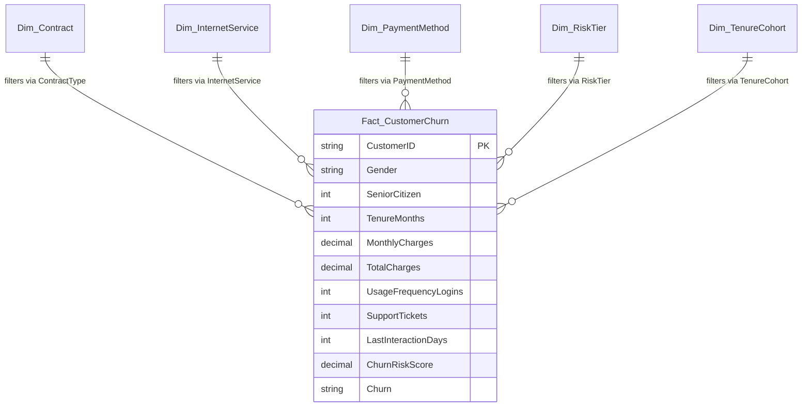

# Power BI Data Model Architecture

## 1. Overview
The **Customer Churn & Retention Analytics Dashboard** is engineered following **Kimball dimensional modeling (Star Schema)** principles to maximize Power BI vertipaq engine compression, fast slicer evaluation, and clean DAX performance.

## 2. Table Specifications

### Fact_CustomerChurn (Central Fact Table)
- **Granularity**: 1 row per customer subscription contract.
- **Keys**: `CustomerID` (PK), foreign keys to dimensions.
- **Additive Measures**: `MonthlyCharges`, `TotalCharges`, `UsageFrequencyLogins`, `SupportTickets`, `LastInteractionDays`, `ChurnRiskScore`.

### Dimension Tables (Star Schema)
1. **Dim_Contract**:
   - `ContractType` (Month-to-month, One year, Two year)
   - `CommitmentMonths` (1, 12, 24)
   - `ContractSortOrder`
2. **Dim_RiskTier**:
   - `RiskTier` (Low, Medium, High, Critical)
   - `MinScore`, `MaxScore`
   - `AlertFlag`, `SortOrder`
3. **Dim_InternetService**:
   - `InternetService` (Fiber optic, DSL, No)
   - `SpeedTier`, `TechnologyType`
4. **Dim_PaymentMethod**:
   - `PaymentMethod` (Electronic check, Mailed check, Bank transfer, Credit card)
   - `IsAutomated` (Yes, No)
5. **Dim_TenureCohort**:
   - `TenureBucket` (0-6m, 7-12m, 13-24m, 25-48m, 48m+)
   - `CohortSortOrder`

## 3. Relationships & Cardinality
- All relationships are **1-to-Many (`1:*`)**, single-direction filter flow from Dimensions to `Fact_CustomerChurn`.
- Bi-directional cross-filtering is strictly avoided to prevent ambiguous filter propagation and performance degradation.
